# AdaptiveTutor (mobile and web client)

AdaptiveTutor is the client app for my final-year BSc project in the Department of
Computer Science, Adeleke University (2026), supervised by Mr Jeremiah Balogun. It is an
Expo / React Native app that runs on Android, iOS and the web.

A student signs in, chooses courses, and works through each course topic by topic. For
each topic the app requests a lesson and a quiz from the backend. The quiz result decides
what happens next: move to a harder quiz, unlock the next topic, or study a remedial
lesson built around the sub-topics the student got wrong. There is also an AI tutor chat,
progress tracking, streaks and badges.

The lesson, quiz, hint, chat and progress logic runs on the backend
([chukaik/adaptive-tutor-backend](https://github.com/chukaik/adaptive-tutor-backend)).
This repository holds only the client.

<table>
  <tr>
    <td>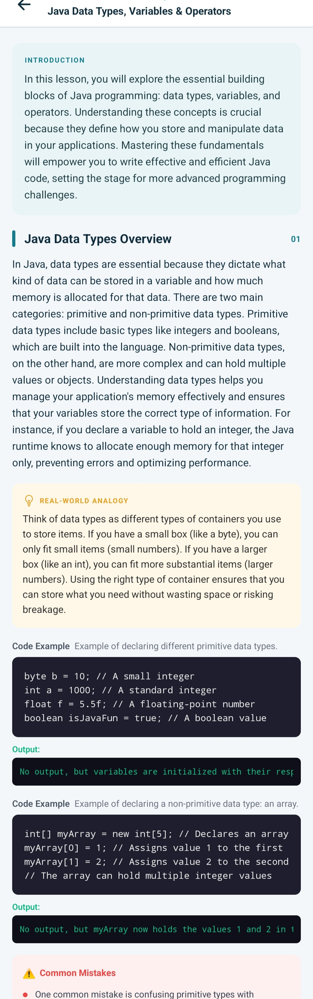</td>
    <td>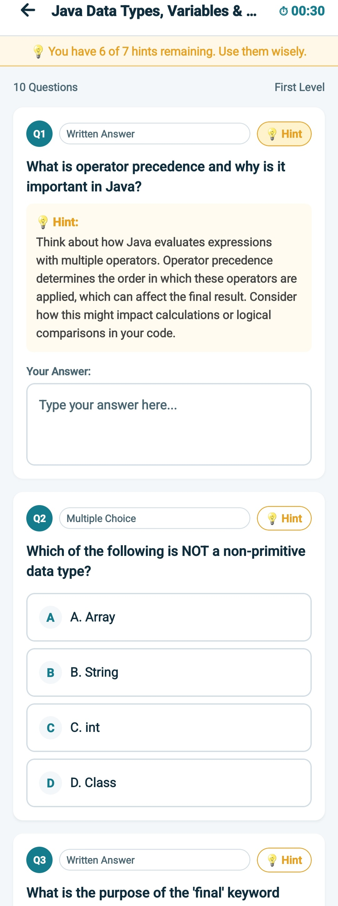</td>
    <td></td>
    <td>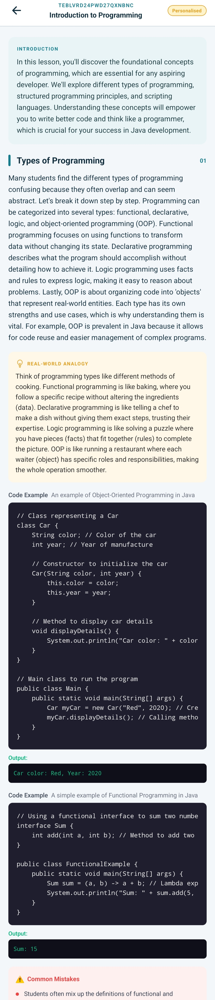</td>
  </tr>
  <tr>
    <td colspan="4" align="center"><em>The adaptive loop: lesson, quiz, result and next step, remedial lesson</em></td>
  </tr>
</table>

More in [Screenshots](#screenshots).

---

## Contents

- [Screenshots](#screenshots)
- [Screens](#screens)
- [Stack](#stack)
- [Code organisation](#code-organisation)
- [Setup](#setup)
- [Running](#running)
- [Building with EAS](#building-with-eas)
- [Backend and external services](#backend-and-external-services)
- [Linting and formatting](#linting-and-formatting)
- [Limitations](#limitations)
- [Licence](#licence)
- [Acknowledgements](#acknowledgements)

---

## Screenshots

### Getting started

<table>
  <tr>
    <td>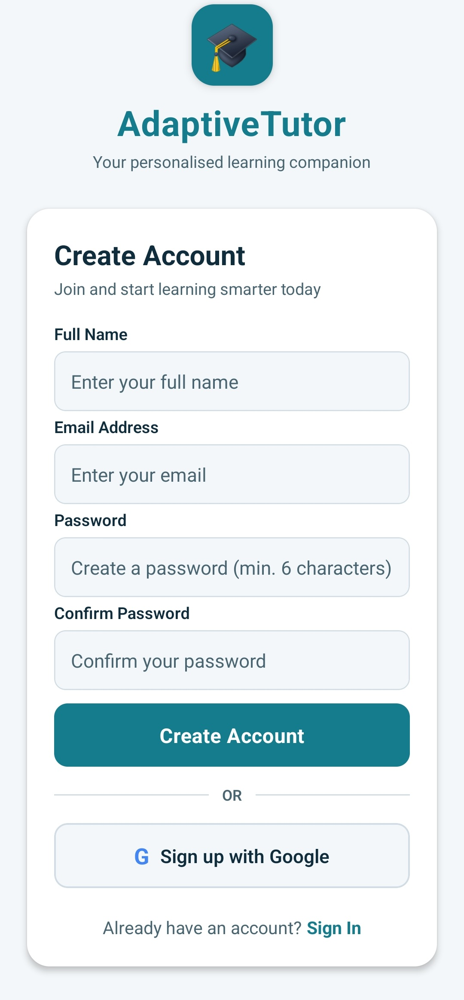</td>
    <td>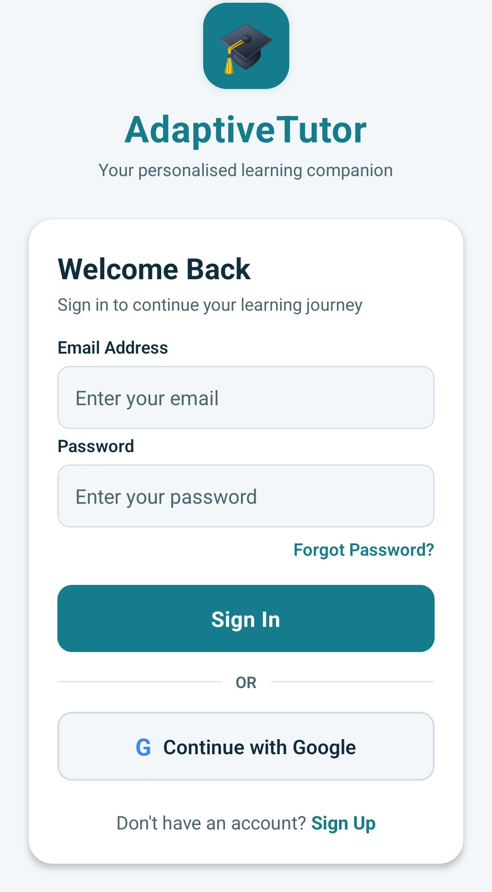</td>
    <td>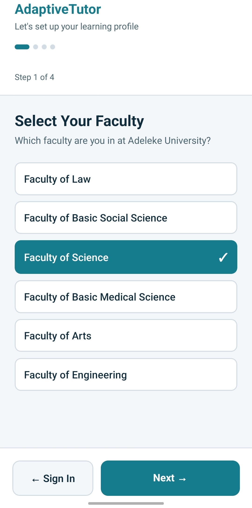</td>
  </tr>
  <tr>
    <td>Sign up with email or Google</td>
    <td>Sign in</td>
    <td>Onboarding step 1: faculty</td>
  </tr>
  <tr>
    <td>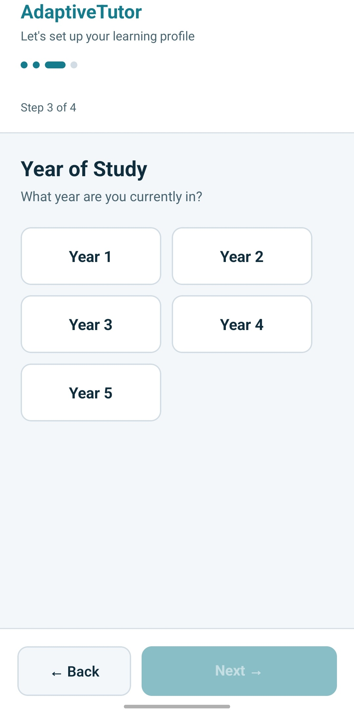</td>
    <td></td>
    <td></td>
  </tr>
  <tr>
    <td>Onboarding step 3: year of study</td>
    <td></td>
    <td></td>
  </tr>
</table>

### Learning

<table>
  <tr>
    <td>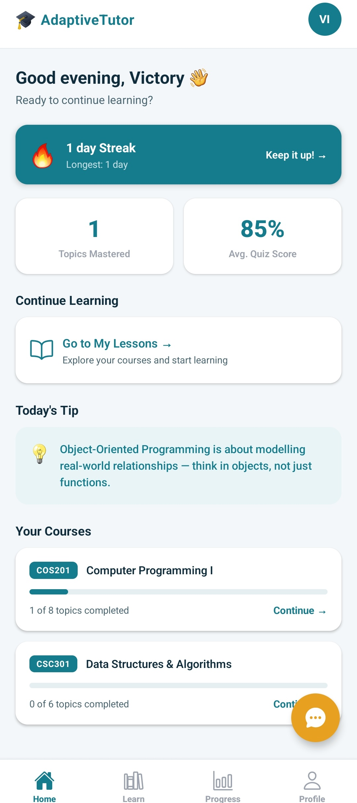</td>
    <td></td>
    <td>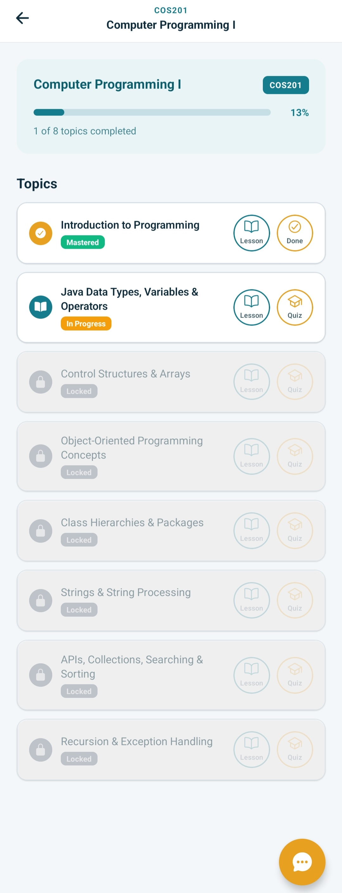</td>
  </tr>
  <tr>
    <td>Home: streak, stats and courses</td>
    <td>Learn: courses, topic status and search</td>
    <td>Course: topics marked Mastered, In Progress or Locked</td>
  </tr>
  <tr>
    <td></td>
    <td></td>
    <td></td>
  </tr>
  <tr>
    <td>Lesson with analogy and code examples</td>
    <td>Quiz with a hint open and the timer</td>
    <td>Result: score, next step and per-question breakdown</td>
  </tr>
  <tr>
    <td></td>
    <td></td>
    <td></td>
  </tr>
  <tr>
    <td>Remedial lesson, marked "Personalised"</td>
    <td></td>
    <td></td>
  </tr>
</table>

### Progress

<table>
  <tr>
    <td>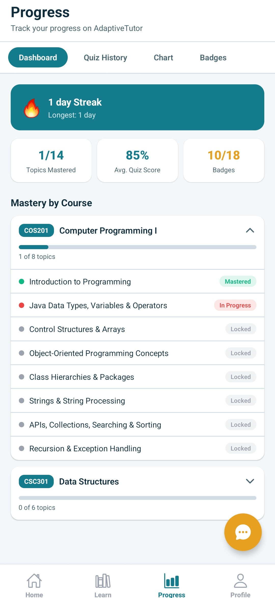</td>
    <td>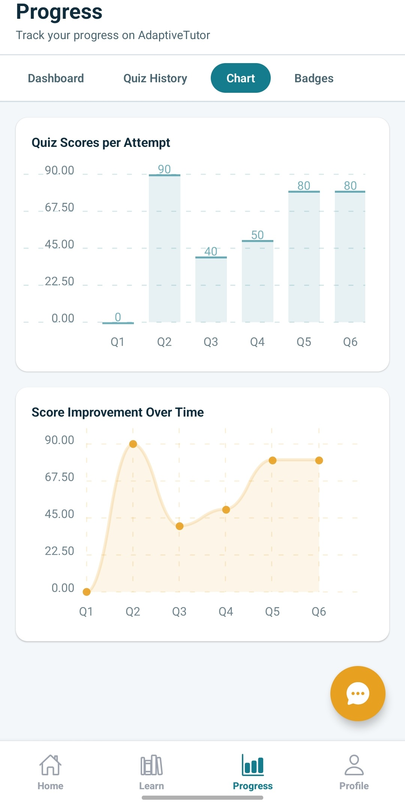</td>
    <td>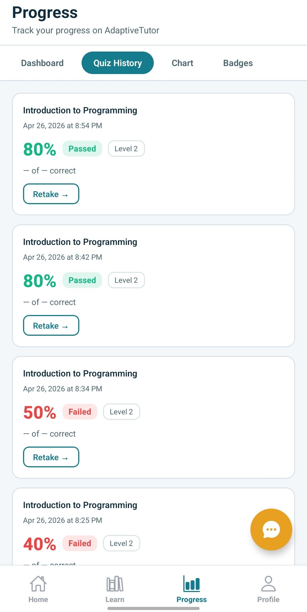</td>
  </tr>
  <tr>
    <td>Dashboard: mastery by course</td>
    <td>Chart: score per quiz attempt</td>
    <td>Quiz history with retake</td>
  </tr>
  <tr>
    <td>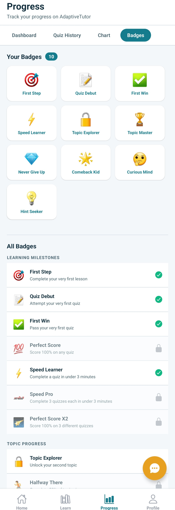</td>
    <td></td>
    <td></td>
  </tr>
  <tr>
    <td>Badges earned and still locked</td>
    <td></td>
    <td></td>
  </tr>
</table>

### Assistant

<table>
  <tr>
    <td>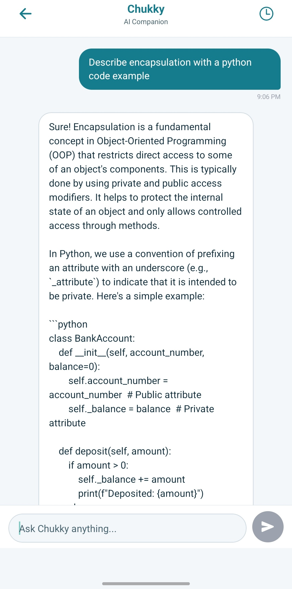</td>
    <td>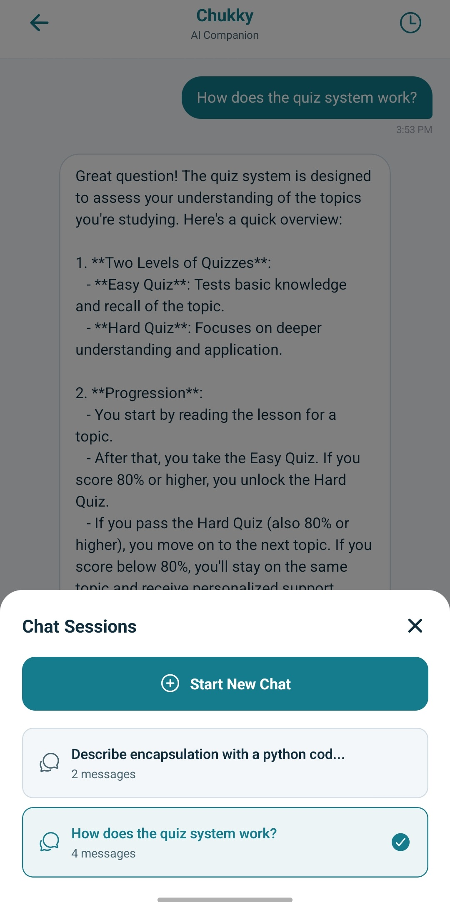</td>
    <td></td>
  </tr>
  <tr>
    <td>Chat with Chukky, the AI tutor</td>
    <td>Chat sessions: switch or start a new one</td>
    <td></td>
  </tr>
</table>

---

## Screens

The app has three states, chosen in `AppNavigator` from Firebase Auth state and the
`onboarding_complete` field on the user's Firestore document:
**signed out → onboarding → main app**.

### Signed out (`src/screens/auth/`)

| Screen | What it does |
| --- | --- |
| `LoginScreen` | Email/password sign-in with Firebase Auth, and "Continue with Google" (Firebase popup on web; `expo-auth-session` on Android). |
| `SignUpScreen` | Creates a Firebase Auth account and a `users/{uid}` document in Firestore. Also offers Google sign-up. |
| `ForgotPasswordScreen` | Sends a Firebase password-reset email. |

### Onboarding (`src/screens/onboarding/`)

| Screen | What it does |
| --- | --- |
| `OnboardingScreen` | Four steps: faculty, department / course of study, year of study, and course selection. On submit it calls `POST /onboarding/complete` on the backend and updates the user's Firestore document. |

### Main app: bottom tabs (`src/screens/main/`)

| Screen | What it does |
| --- | --- |
| `HomeScreen` | Greeting, login streak (calls `POST /progress/streak/update`), topics mastered, average quiz score, a "Continue Learning" shortcut, a tip that changes with the day of the month, and the student's courses. |
| `LearnScreen` | Lists the student's courses and all available courses, each expandable to its topics, with a search box that matches course codes, titles and topic names. |
| `ProgressScreen` | Four tabs: **Dashboard** (summary stats and mastery per course), **Quiz History** (past attempts with a "Retake" button), **Chart** (bar and line charts of quiz scores using `react-native-chart-kit`), and **Badges**. |
| `ProfileScreen` | Shows and edits name, bio and LinkedIn URL; changes the profile photo (uploaded to Cloudinary); adds courses; shows earned badges; dark-mode switch; sign out. |

A floating chat button on every tab opens the AI tutor.

### Main app: stack screens (`src/screens/course/`, `quiz/`, `chat/`)

| Screen | What it does |
| --- | --- |
| `CourseScreen` | Topics in a course with a status for each (Mastered / In Progress / Locked), based on `GET /progress/learning-state/{userId}/{courseId}` and Firestore progress documents. Each topic links to its lesson and its quiz. |
| `TopicScreen` | Shows a lesson from `POST /lesson/fetch`, or a remedial lesson from `POST /lesson/remedial` when the student is sent back after a failed quiz. A lesson can contain an introduction, a real-world analogy, code examples with output, common mistakes, practice tips and a summary. |
| `QuizScreen` | Loads a quiz from `POST /quiz/fetch`, times the attempt, lets the student ask for a hint per question (`POST /quiz/hint`), and submits answers to `POST /quiz/submit`. |
| `QuizResultScreen` | Shows score, pass/fail and a per-question breakdown. Shows a different next step for each `next_action` value the backend returns: `INCREASE_DIFFICULTY` (take the harder quiz), `UNLOCK_NEXT_TOPIC` (go back to the course), or `REPEAT_CONCEPT` (open a remedial lesson for the sub-topics answered wrongly). |
| `ChatScreen` | AI tutor chat ("Chukky") with multiple sessions. Messages go to `POST /chat/message`. When opened from a course or topic, that title is sent as context. Messages are also written to Firestore under `chat_history/{uid}/messages`. |

Two courses are hard-coded in the client: **COS201 Computer Programming I** and
**CSC301 Data Structures**. Their topics come from Firestore and the backend.

---

## Stack

Versions are taken from `package.json` (and match what is installed in `node_modules`).

| Area | Package | Version |
| --- | --- | --- |
| Framework | `expo` | ~55.0.8 |
| | `react-native` | 0.83.2 |
| | `react` / `react-dom` | 19.2.0 |
| | `react-native-web` | ^0.21.0 |
| Navigation | `@react-navigation/native` | ^7.1.34 |
| | `@react-navigation/stack` | ^7.8.6 |
| | `@react-navigation/bottom-tabs` | ^7.15.6 |
| Auth and data | `firebase` (Auth, Firestore) | ^12.11.0 |
| | `expo-auth-session` | ~55.0.9 |
| | `expo-web-browser` | ~55.0.10 |
| | `expo-crypto` | ~55.0.10 |
| Media | `expo-image-picker` | ~55.0.16 |
| Charts | `react-native-chart-kit` | ^6.12.0 |
| | `react-native-svg` | 15.15.3 |
| Updates | `expo-updates` | ~55.0.21 |
| Installed but not imported in `src/` | `@react-native-async-storage/async-storage` 2.2.0, `react-native-paper` ^5.15.0, `expo-status-bar` ~55.0.4 | |
| Dev | `eslint` ^9.39.5, `eslint-config-expo` ~55.0.1, `eslint-config-prettier` ^10.1.8, `prettier` ^3.10.1 | |

Language: JavaScript (no TypeScript). Icons come from `@expo/vector-icons` (bundled with Expo).

---

## Code organisation

```
App.js                     ThemeProvider + AppNavigator
index.js                   registerRootComponent(App)
app.json                   Expo config (bundle IDs, icons, EAS project, update URL)
eas.json                   EAS Build profiles
src/
  navigation/
    AppNavigator.js        Chooses auth / onboarding / main from Firebase Auth state
    AuthNavigator.js       Stack: Login, SignUp, ForgotPassword
    MainNavigator.js       Stack wrapping the bottom tabs (Home, Learn, Progress,
                           Profile) plus Chat, CourseScreen, TopicScreen,
                           QuizScreen, QuizResultScreen; floating chat button
  screens/
    auth/                  LoginScreen, SignUpScreen, ForgotPasswordScreen
    onboarding/            OnboardingScreen
    main/                  HomeScreen, LearnScreen, ProgressScreen, ProfileScreen
    course/                CourseScreen, TopicScreen
    quiz/                  QuizScreen, QuizResultScreen
    chat/                  ChatScreen
  services/
    api.js                 fetch wrapper and one function per backend endpoint
    firebase.js            Firebase app, Auth, Firestore initialisation
    googleAuth.js          Google sign-in (web popup / native ID token) and
                           creation of the users/{uid} document
  constants/
    colors.js              Brand colours, light and dark palettes
    ThemeContext.js        React context for light/dark theme
    courseIds.js           Firestore IDs for the two courses and some topics
    webStyles.js           Style helpers that make ScrollView/FlatList scroll on web
  components/
    AIChatFAB.js           Empty file
    LoadingSpinner.js      Empty file
```

Each screen holds its own state, data fetching (Firestore and `services/api.js`) and
`StyleSheet`. There is no global store and no shared component library yet.

**Data flow.** The client talks to two places:

1. **Firestore, directly**, for the user profile (`users`), progress (`student_progress`),
   quiz history (`quiz_sessions`), topics (`topics`), lesson activity (`user_lessons`)
   and chat history (`chat_history`).
2. **The backend's REST API** (`src/services/api.js`) for anything generated or
   computed: lessons, remedial lessons, quizzes, hints, grading, chat replies, learning
   state, full progress and streaks.

---

## Setup

Requirements:

- Node.js and npm. <!-- TODO(Chukwugozim): state the Node version you develop with. Lint was run here with Node 20.19.4. -->
- For Android: the Expo Go app on a device, or Android Studio with an emulator.
- For iOS: the Expo Go app on an iPhone, or Xcode with a simulator (macOS only).
- For builds: an [Expo](https://expo.dev) account and `eas-cli` (`npm install -g eas-cli`).

```bash
git clone https://github.com/chukaik/adaptive-tutor-frontend.git
cd adaptive-tutor-frontend
npm install
```

### Environment variables

One variable is read from the environment:

| Variable | Used in | If not set |
| --- | --- | --- |
| `EXPO_PUBLIC_API_URL` | `src/services/api.js`: base URL of the backend, without a trailing slash | Falls back to the deployed backend, `https://adaptive-tutor-api.onrender.com` |

To use a different backend (for example one running on your machine), copy
`.env.example` to `.env.local` (git-ignored) and set the variable:

```bash
EXPO_PUBLIC_API_URL=http://localhost:8000
```

Expo inlines `EXPO_PUBLIC_*` variables into the JavaScript bundle at build time, so they
are visible to anyone who has the app. Do not put secrets in them. Restart `npm start`
after changing the file.

Everything else is still hard-coded in the source:

| Setting | Where |
| --- | --- |
| Firebase web config | `src/services/firebase.js` |
| Google OAuth client IDs (web, Android) | `src/screens/auth/LoginScreen.js`, `SignUpScreen.js` |
| Cloudinary cloud name and unsigned upload preset | `src/screens/main/ProfileScreen.js` |
| Course and topic Firestore IDs | `src/constants/courseIds.js` and several screens |

To use your own Firebase project, Google OAuth clients or Cloudinary account, edit those files.

---

## Running

```bash
npm start          # Expo dev server; press a / i / w, or scan the QR code with Expo Go
npm run android    # open on a connected Android device or emulator
npm run ios        # open on the iOS simulator (macOS)
npm run web        # open in the browser
```

The app calls the deployed backend, so you need an internet connection. When a user
signs in, the app sends a request to `/health` to wake the backend. The first lesson or
quiz after a period of inactivity can still be slow.

**Google sign-in by platform.** On web it uses the Firebase popup. On Android it uses
`expo-auth-session` with the Android client ID. No iOS client ID is configured, so Google
sign-in is not expected to work on iOS. Email/password sign-in does not depend on the platform.
<!-- TODO(Chukwugozim): confirm which platforms you have tested Google sign-in on, and whether it works in Expo Go. -->

---

## Building with EAS

The project is linked to an EAS project (`app.json → extra.eas.projectId`, owner
`chukkyik`). `eas.json` defines two build profiles, both producing an Android **APK**:

```bash
eas login
eas build -p android --profile preview      # installable APK for testing
eas build -p android --profile production   # also an APK (not an AAB)
```

App identifiers: `com.adeleke.adaptivetutor` (Android package and iOS bundle ID).

No iOS-specific build settings are in `eas.json`. An iOS build would use EAS defaults and
needs an Apple Developer account. <!-- TODO(Chukwugozim): state whether an iOS build has ever been made. -->

**Over-the-air updates.** `expo-updates` is installed, `app.json` sets an `updates.url`,
and `runtimeVersion.policy` is `appVersion`. A JS-only change can be published to
existing builds with the same app version using `eas update`.
<!-- TODO(Chukwugozim): confirm the channel/branch you publish updates to, or remove this paragraph if you do not use updates. -->

---

## Backend and external services

| Service | Used for |
| --- | --- |
| [adaptive-tutor-backend](https://github.com/chukaik/adaptive-tutor-backend), deployed at `https://adaptive-tutor-api.onrender.com` | Onboarding, lessons, remedial lessons, quizzes, hints, grading and next action, personalised quizzes, chat, learning state, progress, streaks |
| Firebase Authentication | Email/password and Google sign-in |
| Cloud Firestore | User profiles, progress, quiz sessions, topics, chat history (read and written directly by the client) |
| Cloudinary | Profile photo upload (unsigned preset) |

Backend endpoints called by the client (from `src/services/api.js`):

```
POST /onboarding/complete            POST /quiz/fetch
POST /lesson/fetch                   POST /quiz/submit
POST /lesson/remedial                POST /quiz/hint
GET  /lesson/history/{uid}/{topic}   POST /quiz/generate-personalized
POST /chat/message                   GET  /progress/{uid}
GET  /chat/sessions/{uid}            GET  /progress/learning-state/{uid}/{course}
POST /chat/sessions/{uid}            POST /progress/streak/update
GET  /chat/history/{uid}             GET  /health
```

`getLessonHistory`, `generatePersonalizedQuiz` and `getChatHistory` are defined in
`api.js` but not called from any screen.

How lessons and quizzes are generated, and how the next action is decided, is documented
in the backend repository. <!-- TODO(Chukwugozim): link the specific backend README section once it exists. -->

---

## Linting and formatting

ESLint uses Expo's config (`eslint-config-expo`, flat config in `eslint.config.js`).
`eslint-config-prettier` turns off rules that would conflict with Prettier. Prettier is
configured in `.prettierrc.json`. It sets only `singleQuote: true`, to match the existing
code, and otherwise uses Prettier's defaults.

```bash
npm run lint           # expo lint
npm run format:check   # report files Prettier would change
npm run format         # rewrite files with Prettier
```

The existing code has **not** been reformatted yet. When this was set up, on the
committed sources:

- `expo lint` reported **51 problems: 6 errors and 45 warnings**. The errors are all
  `react/no-unescaped-entities` (apostrophes in JSX text). The warnings are 39
  `no-unused-vars` and 6 `react-hooks/exhaustive-deps`.
- Prettier would reformat **24 of 27** JavaScript files.

---

## Limitations

- **No automated tests.** There are no unit, component or end-to-end tests in this
  repository, and no CI. All testing so far has been manual.
- **Two screen files are over 1,000 lines and should be split** into smaller
  components and hooks (data fetching, badge logic, sub-views):
  - `src/screens/main/ProgressScreen.js`: 1,127 lines
  - `src/screens/main/ProfileScreen.js`: 1,084 lines

  Two more are close behind: `src/screens/chat/ChatScreen.js` (811) and
  `src/screens/main/LearnScreen.js` (807).
- **Most configuration is hard-coded** (see [Environment variables](#environment-variables)).
  Only the backend URL can be set from the environment (`EXPO_PUBLIC_API_URL`). Changing
  the Firebase project, Google sign-in client IDs or Cloudinary account means editing source.
- **Duplicated data and logic.** The course list (IDs, codes, titles) is defined in
  several screens rather than once, and only two courses exist. Badge rules are
  implemented separately in `ProfileScreen` and `ProgressScreen`.
- **Badges and some statistics are computed on the client** from Firestore reads, so they
  are not authoritative and could be changed by a modified client.
- **Security depends on Firestore rules that are not in this repository.** The client
  reads and writes Firestore directly.
  <!-- TODO(Chukwugozim): say where the Firestore security rules live, or add them. -->
- **Auth persistence on native is not set up.** `firebase/auth` is initialised with
  `getAuth()` and AsyncStorage is installed but not connected. Users may have to sign in
  again after restarting the app on Android/iOS.
  <!-- TODO(Chukwugozim): confirm this behaviour on a device. -->
- **Dark mode is not saved.** The theme toggle is held in React state only. A
  `theme_mode` field is written to the user document but never read.
- **Google sign-in on iOS is not configured** (no iOS client ID).
- **No accessibility work yet.** No `accessibilityLabel`s are set, and screen-reader use has
  not been tested.
- **Leftovers:** two empty component files (`src/components/AIChatFAB.js`,
  `LoadingSpinner.js`), three unused dependencies (see [Stack](#stack)), large blocks of
  commented-out code in some screens, and the lint findings above.

---

## Licence

[MIT](LICENSE) © 2026 Chukwugozim Victory Ikeyina.

## Acknowledgements

- Mr Jeremiah Balogun, project supervisor, Department of Computer Science, Adeleke University.
- Built with [Expo](https://expo.dev), [React Navigation](https://reactnavigation.org),
  [Firebase](https://firebase.google.com) and
  [react-native-chart-kit](https://github.com/indiespirit/react-native-chart-kit).
<!-- TODO(Chukwugozim): add anyone else you want to thank (e.g. students who tested the app, lecturers whose course outlines you used for COS201/CSC301). -->
